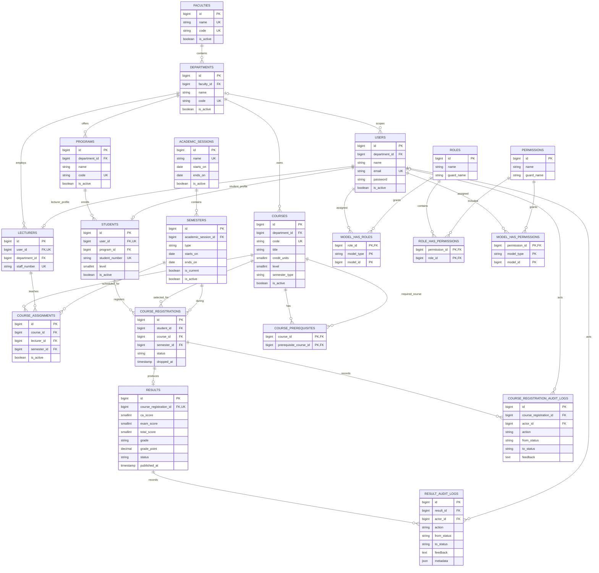

# Database Design

The schema is relational and uses foreign keys, unique constraints, indexes, and PostgreSQL boolean columns. Linked academic records generally use restricted deletion so that historical registrations and results are not silently removed. Archiving is represented by `is_active` flags.

## Entity relationship diagram

`MODEL_HAS_ROLES` and `MODEL_HAS_PERMISSIONS` are Spatie polymorphic assignments: `model_type` and `model_id` identify the role-bearing model (currently `users`). `COURSE_PREREQUISITES` is a self-referencing many-to-many relation between courses. The database also has framework support tables for sessions, password reset tokens, cache, jobs, and migrations; they are omitted from this academic-domain diagram.

## Important constraints

- A student and lecturer each have at most one profile per user (`user_id` is unique).
- A course can be registered once per student per semester (`student_id`, `course_id`, `semester_id` unique). Dropping and re-adding updates the same registration and records the transition.
- Each registration has at most one result (`results.course_registration_id` is unique), preserving the specific course attempt.
- A course assignment is unique per course, lecturer, and semester.
- One active academic session and one current semester are protected by partial unique indexes.
- Deleting referenced academic structures is restricted; audit actor references become null if an actor account is deleted, and audit history cascades with its result.
- Result records hold score totals, calculated grade/point, workflow state, timestamps, and feedback. Detailed state transitions are separately recorded in `result_audit_logs`.
